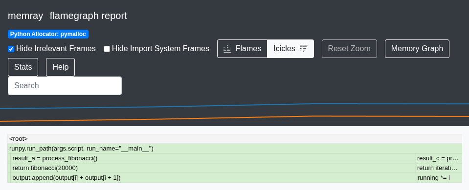
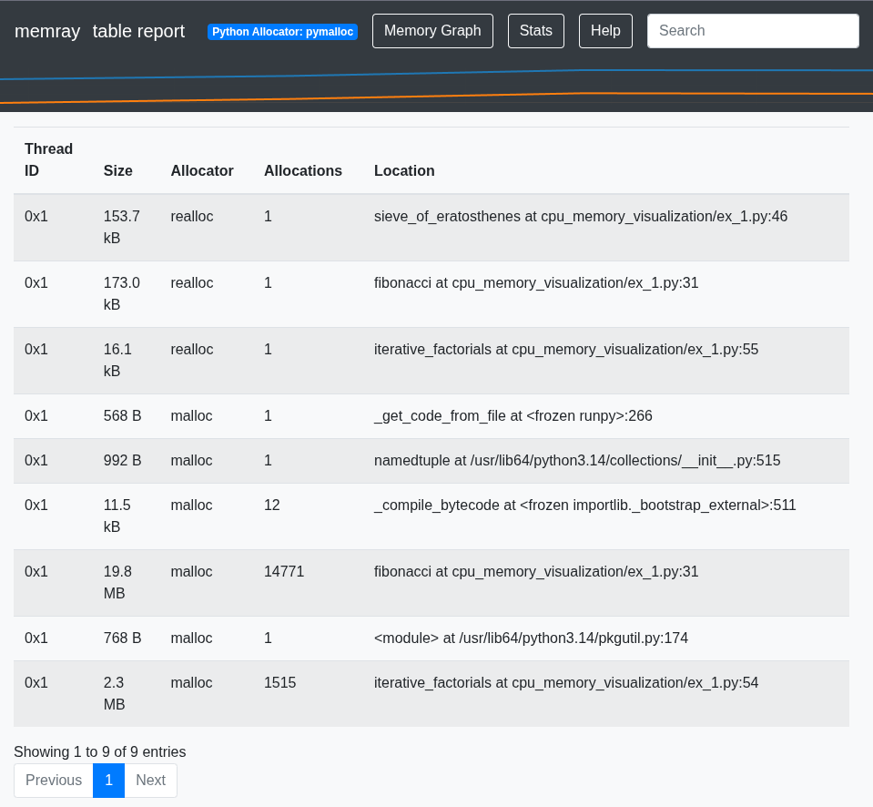
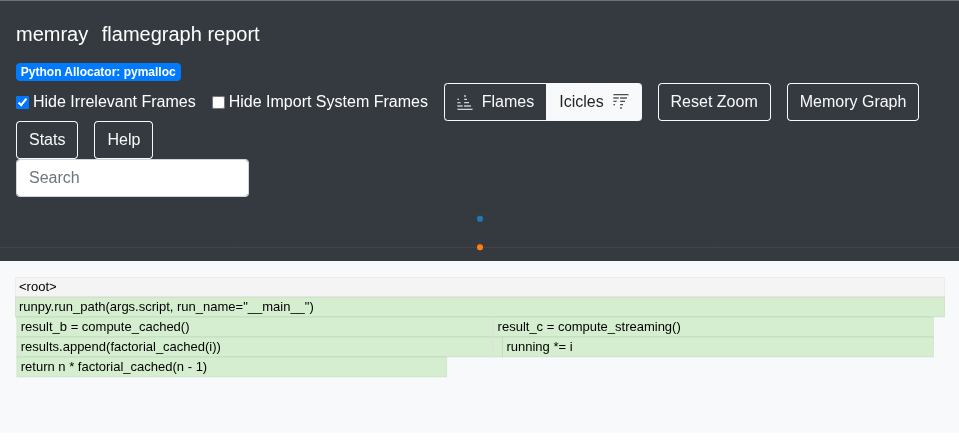
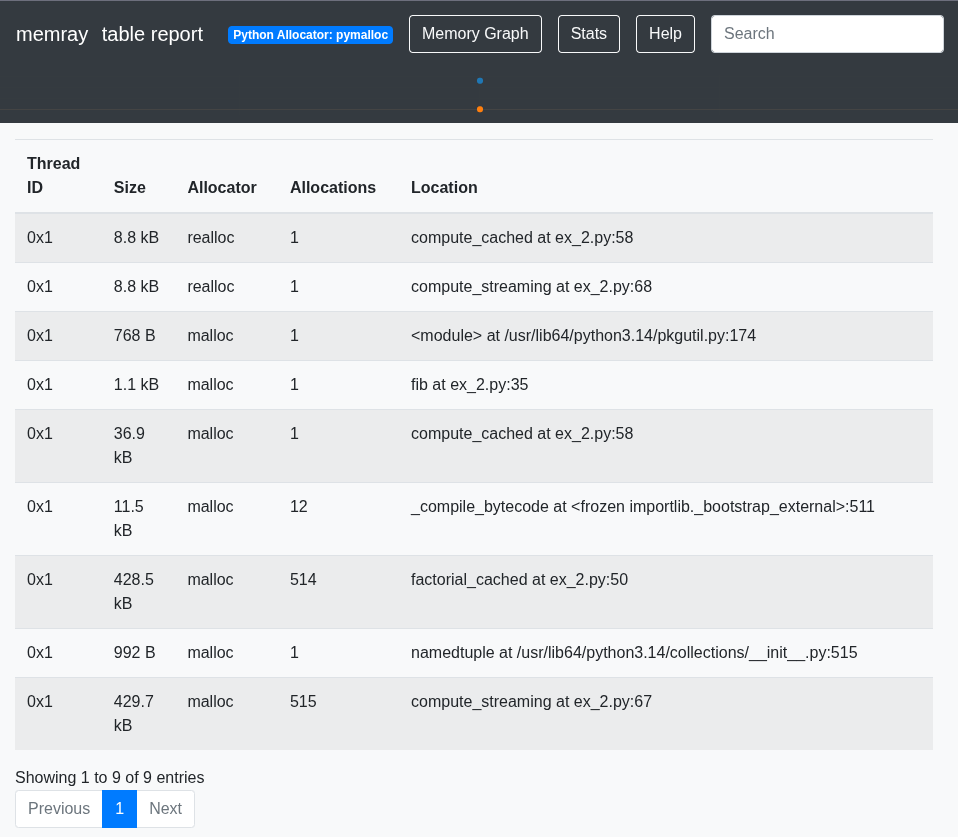
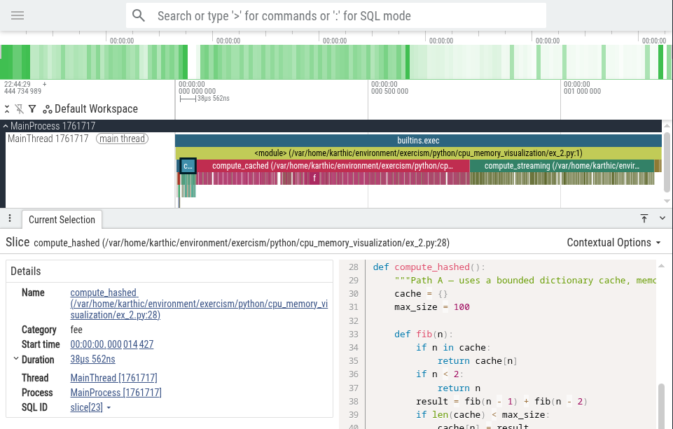

## Generate Flamegraph

```bash
uv run memray run <file>
```

Use the `--native` flag to see details on the native call stack leading to each allocation.

```bash
uv run memray run --native <file>
```

## Visualize Flamegraph

```bash
uv run memray flamegraph <generated bin file>
```

Open the generated html file in the browser

## Generate Table Report

```bash
uv run memray table <generated bin file>
```

Generates an interactive HTML table showing all allocations contributing to peak memory usage. Open the generated HTML file in the browser for a sortable view of allocation size, function names, file paths, and line numbers.

**Useful options:**
- `--top-level` — only show top-level allocating functions (no library internals)
- `--threshold <value>` — filter out allocations below a size threshold (e.g., `--threshold 1MB`)

## Generate CPU Profile

```bash
uv run viztracer <file>
```

## Visualize CPU Profile

```
uv run vizviewer result.json
```

The command opens the result in the browser

## Exercises

### ex_1.py

This exercise demonstrates **two different memory anti-patterns** in a single file. Three code paths run together — two have memory issues, one is clean. The profiling reports make it easy to distinguish the problematic paths by showing which functions dominate memory allocations.

- **Path A (problematic):** `process_fibonacci` → `fibonacci` — retains a large list of big integers when only the sum is needed
- **Path B (problematic):** `process_image` → `_unused` / `_unused_pow` — lingering references keep intermediate numpy arrays alive
- **Path C (clean):** `process_primes` → `sieve_of_eratosthenes` — uses a compact boolean array




### ex_2.py

Three paths: `compute_hashed`, `compute_cached`, and `compute_streaming`. The cached path uses an unbounded `@functools.cache` that grows with every unique call.

- **Path A (clean):** `compute_hashed` — uses a bounded dictionary cache (max 100 entries)
- **Path B (problematic):** `compute_cached` → `factorial_cached` — unbounded `@functools.cache` stores every unique `n` forever
- **Path C (clean):** `compute_streaming` — iterative computation with no cache at all




