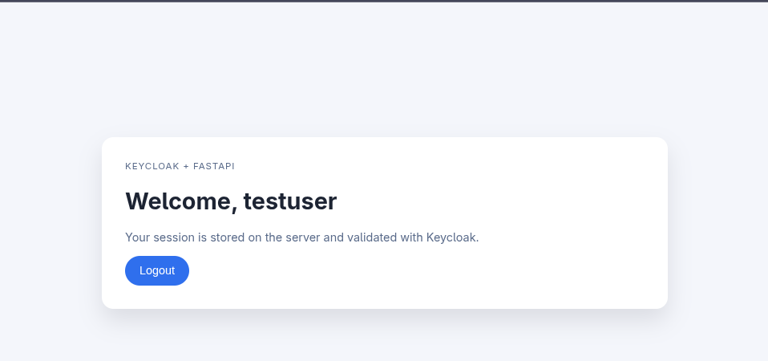

# Keycloak FastAPI exercise

This exercise builds a small server-side rendered FastAPI app that authenticates against the local Keycloak realm defined in `../../keycloak/main.tf` using Authlib for OIDC.

Make sure that the Keycloak server is running as per instructions in `../../keycloak/README.md`

## Run

```bash
KEYCLOAK_BASE_URL=http://127.0.0.1:8080 \
KEYCLOAK_CLIENT_SECRET=... \
uv run uvicorn app:app --reload --host 127.0.0.1 --port 3000
```

## Test

```bash
uv run pytest -q keycloak_exercise/test_app.py
```


