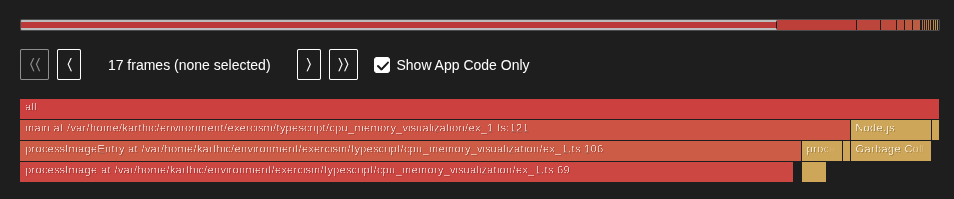
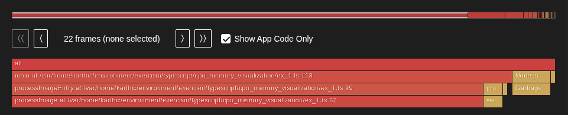

## Compile TypeScript

```bash
npx tsc
```

## Generate Flamegraph

```bash
npx flame run --sourcemap-dirs=dist dist/cpu_memory_visualization/<file>.js
```

Open the generated HTML file in the browser. Two files are generated: one for CPU time and one for heap memory.

## Profiling Notes

Flame uses V8's **sampling-based** heap profiler, which takes periodic snapshots of the current heap state. This differs from Python's memray, which **tracks every allocation** deterministically. The key differences:

- **Single-column flamegraph**: Since the three code paths run sequentially, V8 sampling captures only the path executing at the time of each snapshot. The dominant path (largest memory consumer) appears as a single tall column, rather than sibling branches side by side as in memray's flamegraph.
- **Async delays**: The exercise file uses `async/await` delays between code paths so the sampler has a chance to capture each one. Without delays, the dominant path would consume nearly all samples.
- **Sample density**: V8 takes one sample per ~512KB allocated. A path that allocates 20MB will dominate the samples over a path that allocates 150KB.

## Exercises

### ex_1.ts

This exercise demonstrates **two different memory anti-patterns** in a single file. Three code paths run together — two have memory issues, one is clean. The profiling reports make it easy to distinguish the problematic paths by showing which functions dominate memory allocations.

- **Path A (problematic):** `processFibonacci` → `fibonacci` — retains a large array of BigInts when only the sum is needed
- **Path B (problematic):** `processImage` → `_unused` / `_unusedPow` — lingering references keep intermediate arrays alive
- **Path C (clean):** `processPrimes` → `sieveOfEratosthenes` — uses a compact boolean array



